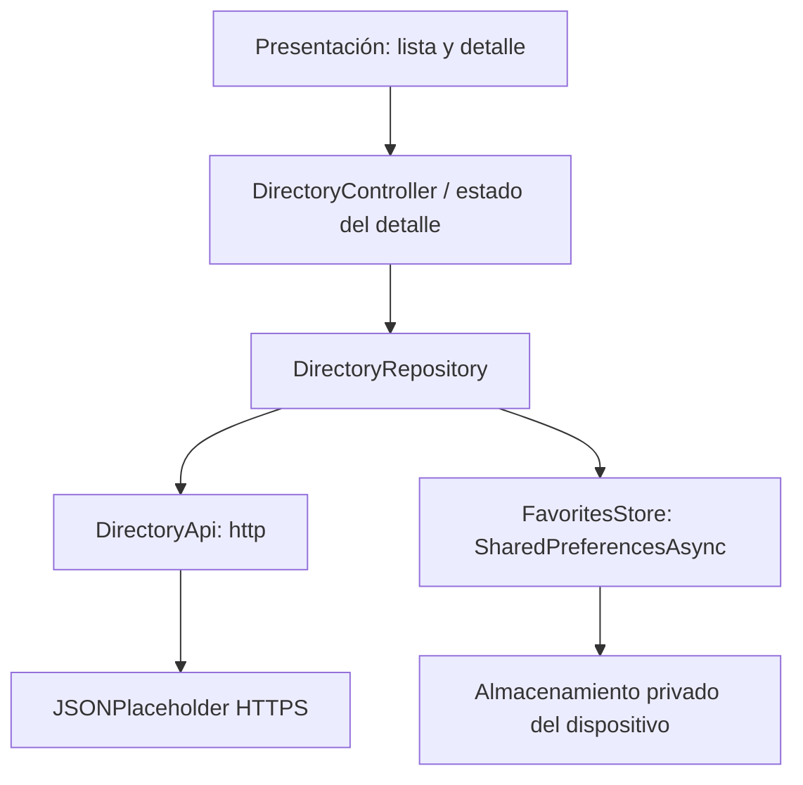

# Directorio UTESA — Tarea 5

Aplicación Android desarrollada en Flutter/Dart. Consulta JSONPlaceholder mediante `http` y conserva los usuarios favoritos completos mediante `SharedPreferencesAsync`.

## Ejecutar

Requisitos: Flutter (validado con 3.47.7 / Dart 3.13.5), Android SDK y Java de Android Studio.

```sh
flutter pub get
flutter run
```

Abrir esta carpeta en Android Studio con los plugins Flutter y Dart. `android/local.properties` es local y no se versiona. Flutter lo genera para cada equipo.

```sh
flutter analyze
flutter test
flutter build apk --debug
```

El APK de desarrollo se genera en `build/app/outputs/flutter-apk/app-debug.apk`. No es una publicación firmada para Play Store.

## Funciones

- Usuarios: `GET https://jsonplaceholder.typicode.com/users`.
- Detalle con información del usuario y `GET /posts?userId={id}`.
- Estrella para guardar/quitar favoritos; se persiste el JSON completo del usuario.
- Favoritos accesibles tras reiniciar la aplicación y sin conexión.
- Carga, mensajes de error, reintento, estado vacío y aviso de falta de red.
- Tiempo máximo de solicitud: 15 segundos. Se manejan errores HTTP y de lectura/red sin cerrar la app.
- Manifest principal declara INTERNET y ACCESS_NETWORK_STATE.

## Arquitectura por capas



`lib/data/models.dart`: modelos. `repository.dart`: API y persistencia. `presentation/controller.dart`: estado y operaciones de la lista y favoritos. `main.dart`: pantallas y estado de las publicaciones. La arquitectura es por capas, no una implementación estricta de MVVM: el detalle administra su propio estado y usa los servicios del repositorio.

`initState` inicia la carga una vez por instancia de pantalla. `build` dibuja el estado y no solicita datos. `dispose` libera el controlador, la suscripción de conectividad y el cliente HTTP. Antes de actualizar el detalle después de una operación asíncrona se comprueba `mounted`. La navegación mantiene la lista montada. Al destruir el proceso se pierde el estado en memoria, pero se vuelven a leer los favoritos del almacenamiento local al iniciar.

## Persistencia y límites

Para los 10 usuarios públicos de esta práctica basta un valor JSON pequeño. No se usa este mecanismo para contraseñas, tokens ni datos críticos. En un directorio grande se usaría SQLite/Room o una base equivalente. No se almacenan publicaciones ni se sincronizan favoritos con un servidor. Sin Internet el detalle del favorito muestra sus datos y explica que las publicaciones requieren conexión. Tener Wi-Fi no garantiza acceso al servidor: también se capturan fallos HTTP y tiempos de espera.

## Validación manual

1. Con Internet, abrir la lista y comprobar nombre, correo y empresa.
2. Tocar un usuario y comprobar sus publicaciones.
3. Marcar una estrella y abrir Favoritos.
4. Cerrar completamente la app, desactivar Wi-Fi y datos móviles y volver a abrirla.
5. Abrir Favoritos y su detalle: los datos personales permanecen; las publicaciones muestran aviso sin conexión.
6. Restaurar Internet y usar Actualizar/Reintentar.

Las capturas y los informes de la entrega están en las carpetas correspondientes del repositorio.

Repositorio: https://github.com/LAL0098/Moviles_Utesa
